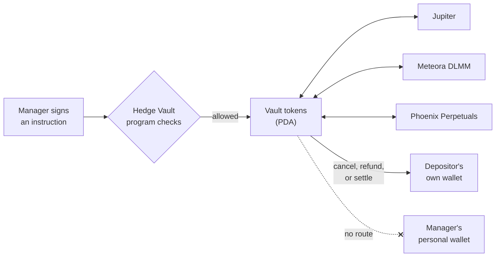
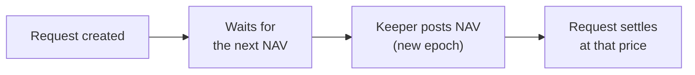
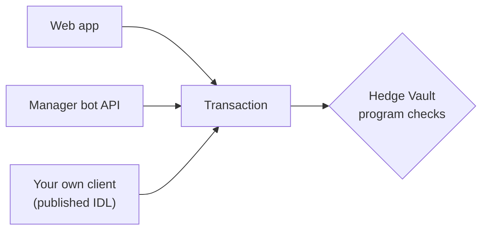

Hedgin runs investment vaults on Solana. A **vault** is a shared pot of one token, such as USDC. Depositors put tokens into the pot. A manager invests the pot through three trading venues. Every action follows rules written into a Solana program, so nobody, including the manager and Hedgin, can take the money out by another route.

## The program holds the money, not the manager

A **Solana program** is code stored on the Solana blockchain. Hedgin's program is called Hedge Vault. Its program ID is `r2ahBQ6gbPCJ9FxBymYcXuwXi8NmenRry7SE7QR7FAt`.

Each vault's tokens sit in token accounts controlled by a **program-derived address (PDA)**. A PDA is an address that only the program can sign for. No person has a private key for it. The manager signs instructions that ask the program to act, and the program decides whether the request is allowed.

A manager can trade a vault's tokens but cannot send them to a personal wallet. The program only moves vault tokens to these places:

| Destination | What it is |
| --- | --- |
| [Jupiter](/managers/jupiter-swaps) | A swap router that exchanges one token for another. |
| [Meteora DLMM](/managers/meteora-dlmm) | A pool where the vault provides liquidity and earns trading fees. |
| [Phoenix Perpetuals](/managers/phoenix-perps) | A market for leveraged long and short positions. |
| The depositor's own wallet | Only when a request is cancelled, refunded, or settled. |

## Who does what

Each role below is a Solana public key that the program checks before it acts.

| Role | What it can do |
| --- | --- |
| Depositor | Creates and cancels its own deposit and withdrawal requests. |
| Manager | Owns one or more vaults. Changes vault settings, trades through Jupiter, Meteora DLMM, and Phoenix, claims manager fees, and closes empty strategies and vaults. |
| NAV keeper | A Hedgin service that values each vault every 4 hours and posts the result on chain. It cannot move vault tokens. |
| Resolver | Anyone. A resolver submits the transaction that settles a ready request. It cannot change the outcome. |
| Hedgin administrator | Adds managers to the whitelist, sets protocol-wide limits, can pause the protocol or a single vault, and can refund a pending request. |

<Note>
The manager role is permanent for a vault. The program has no instruction that moves a vault to a new manager key, so the wallet that creates a vault controls it for its whole life.
</Note>

## The chain is the source of truth

The program stores every number that matters: token balances, share supply, posted value, fees, open requests, and status. The website, the manager bot API, and the keeper all read this state. None of them can override it.

| What you see | What it means |
| --- | --- |
| A number on the website | It can be a few seconds old, or partly priced when a price feed is missing. The value the program stores is the one used for accounting. |
| A check passing on the website | The website checks your action before you sign, so you see most errors early. The program checks the same rules again when the transaction runs, so the transaction can still fail. |
| A Hedgin API key | It lets a bot ask the server to build transactions. It cannot sign them. The manager's wallet key still signs every action. |

## Deposits and withdrawals wait for a valuation

A vault's tokens are spread across idle cash, swapped tokens, liquidity positions, and perpetual positions. Their total value changes every second. To price a deposit or a withdrawal fairly, Hedgin needs one agreed value for a moment in time.

So deposits and withdrawals are **requests**. A request waits until the keeper posts a new value for the vault. That value is the **net asset value (NAV)**: the total value of the vault, and from it the value of one vault share. The keeper posts NAV at most once per **epoch**, a fixed 4-hour window.

This delay is the main trade-off in the design. Depositors wait up to a few hours. In return, nobody can deposit or withdraw at a stale price while the manager's positions move. [Vaults and NAV](/concepts/vaults-and-nav) explains the timing in detail.

## Three surfaces for three audiences

| Surface | Audience | Covers |
| --- | --- | --- |
| [Web app](https://hedgin.xyz/vaults) | Everyone | Every user action: browsing vaults, deposits, withdrawals, and the full manager console. |
| [Manager bot API](/api-reference/introduction) | A manager's bot | Most manager actions. Not deposits, withdrawals, or request settlement. |
| [Published IDL](https://hedgin.xyz/idl/hedge_vault.json) | Teams with their own Solana client | Every program instruction. The IDL is a program interface, not a list of HTTP endpoints. |

All three surfaces end in the same place: a transaction that the program checks. [How transactions work](/concepts/transactions) describes that path.
