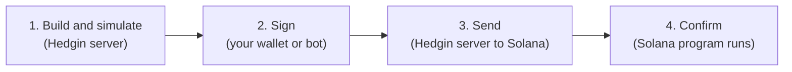
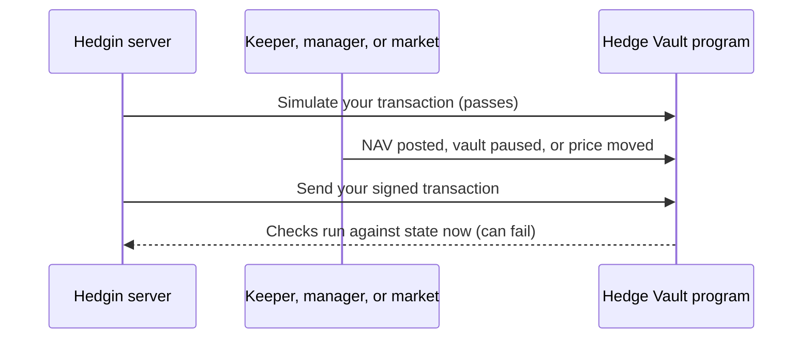
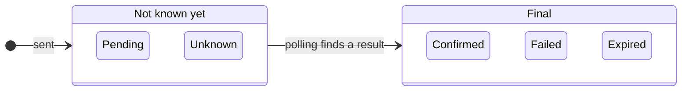
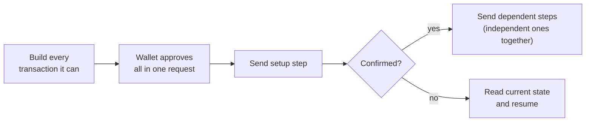

Every change to a Hedgin vault is a Solana **transaction**: a signed message that asks the program to do something. Deposits, swaps, fee claims, and vault settings all follow the same path. "Sent" does not mean "done".

## Four stages, four different results

A Hedgin transaction passes through four stages. Each stage can succeed while the next one fails.

<Steps>
  <Step title="Build and simulate">
    The Hedgin server reads current chain state and builds an unsigned transaction. It then **simulates** it: a dry run against current state that changes nothing. If the dry run fails, the server returns an error and nothing reaches your wallet.
  </Step>
  <Step title="Sign">
    Your wallet shows you the transaction, and you approve it. A manager bot signs with its own key instead. The Hedgin server never holds your key.
  </Step>
  <Step title="Send">
    Your browser or bot returns the signed transaction to the Hedgin server. The server checks it and sends it to the Solana network.
  </Step>
  <Step title="Confirm">
    A Solana validator runs the transaction. The Hedge Vault program checks every rule again: who signed, which accounts, which tokens, which status, and which limits. The transaction is confirmed only when it lands in a block without an error.
  </Step>
</Steps>

Only stage 4 proves that the action happened. A successful simulation, a wallet signature, and an accepted send are all steps toward it.

## Why the program checks everything again

Time passes between the build and the confirmation. Another transaction can change the vault in that gap.

The program runs its checks at the moment the transaction executes, against the state at that moment. So a transaction can pass simulation and still fail on chain. The website shows the program's error when that happens. Read the current state and try again if the action still makes sense.

## Waiting for confirmation

After the server sends a transaction, the website polls its status until it reaches a final result.

| Status | Final? | Meaning |
| --- | --- | --- |
| **Confirmed** | Yes | The transaction landed and the program accepted it. |
| **Failed** | Yes | The transaction landed, but the program rejected it. Nothing changed. |
| **Expired** | Yes | The transaction did not land before its recent blockhash expired. It can never land later. |
| **Pending** | No | The network has not reported a result yet. |
| **Unknown** | No | The send step did not get a clear answer, for example because of a network timeout. |

A **blockhash** is a recent block ID that every Solana transaction carries. After about one minute, the network refuses a transaction with an old blockhash.

<Warning>
A pending or unknown transaction may still land. Before you repeat an action, wait for its status to become confirmed, failed, or expired. If you repeat it too early, both transactions can succeed. For a swap, that means two swaps.
</Warning>

## Actions that need more than one transaction

Some actions do not fit in one Solana transaction. A wide Meteora DLMM position, for example, can span hundreds of price bins and needs several transactions. Some setup steps must confirm before the next step can be built.

The website waits for each required step to confirm before it sends the steps that depend on it. Independent steps go out together.

<Note>
If a step fails in the middle, the steps that already confirmed stay confirmed. Solana cannot undo them. The website reads the current state, and you can resume from there. For example, a restarted DLMM zap-out builds transactions only for the bins that still hold tokens.
</Note>

## The same rules apply to bots

The [manager bot API](/api-reference/introduction) follows the same four stages.

| Stage | Website | Bot |
| --- | --- | --- |
| Build and simulate | Hedgin server | Hedgin API |
| Sign | Your wallet | The bot, locally, with the manager key |
| Send | Hedgin server | Hedgin API |
| Confirm | Website polls status | Bot polls status |

An API key lets a bot request builds. It does not replace the manager's signature, and it cannot pass any check the program would reject.

The API adds a few rules for bots, such as short-lived build tickets and receipts for status polling. [Send and status](/api-reference/send-and-status) describes them.
