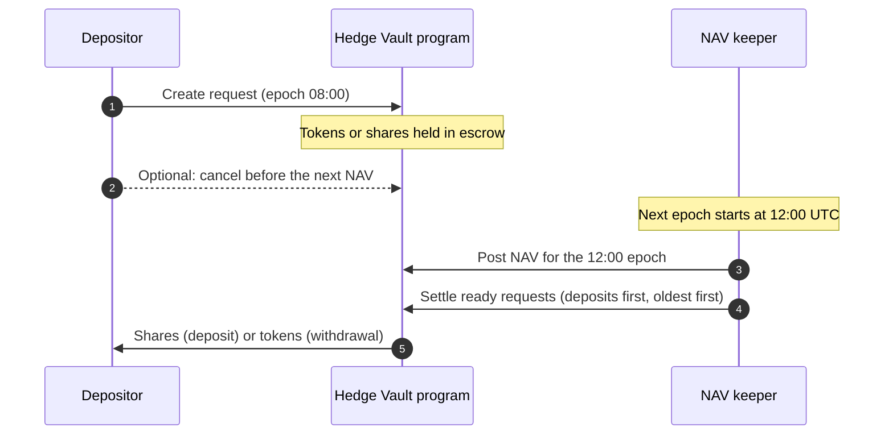

Every Hedgin vault answers one question every 4 hours: what is one share worth right now? This page explains how that answer is produced and why deposits, withdrawals, and fees all depend on it.

## A vault is one token in, shares out

Each vault accepts exactly one token, called its **deposit token**. A USDC vault accepts USDC. A SOL vault holds wrapped SOL, and the website wraps and unwraps your SOL for you. The manager picks the deposit token when creating the vault and cannot change it later.

When you deposit, the vault gives you **shares**. A share is a token that represents your slice of the vault. If you hold 10% of all shares, you own 10% of everything the vault holds. Each vault has its own share token.

The vault page shows these facts about a vault:

- **Status**: whether the vault is open, reduce-only, or paused. The section [What the status and pause switches block](#what-the-status-and-pause-switches-block) explains each one.
- **Total assets**: the vault's value at the last posted NAV, in the deposit token.
- **NAV per share**: the value of one share, in the deposit token.
- **Limits**: the deposit cap, the smallest deposit, and the smallest withdrawal.
- **Fees**: the manager's performance fee and management fee.

The vault's name, logo, description, and tags are display information. They are not stored in the Solana program and do not affect how the vault works.

## NAV is the price of one share

**Net asset value (NAV)** is the total value of everything the vault holds. **NAV per share** is that total divided by the number of shares. A new vault starts at a NAV per share of exactly 1 deposit token.

For example, a USDC vault holds tokens worth 110,000 USDC and has 100,000 shares. Its NAV per share is 1.10 USDC. A depositor who adds 1,100 USDC at that NAV receives 1,000 shares.

The Hedgin keeper calculates NAV. The **keeper** is a Hedgin service that reads the vault's holdings from the chain, prices them, and posts the total to the Solana program. The keeper can post a value. It cannot move vault tokens.

### What the keeper counts

The keeper counts only holdings that the program tracks for the vault:

- The idle balance: deposit tokens sitting in the vault and not invested.
- Each token the vault bought through a [Jupiter swap](/managers/jupiter-swaps).
- Each [Meteora DLMM](/managers/meteora-dlmm) position, including its unclaimed trading fees.
- Each Meteora DLMM limit order, including filled amounts and maker fees.
- The vault's [Phoenix](/managers/phoenix-perps) account value, including open profit and loss. This value never counts below zero.

Tokens that someone sends to a vault address outside these paths are not counted. Unclaimed Meteora farming rewards are not counted.

The keeper converts every holding into the deposit token with Jupiter price data. All prices for one valuation come from one price request.

### Incomplete data stops the post

If the keeper cannot price a token, cannot read an account, or finds a Phoenix market price older than about 10 minutes, it does not post. It never treats a missing value as zero. A wrong NAV would let one depositor gain at another's expense, so a late NAV is the safer failure. The keeper tries again on its next run.

The program also limits how far NAV per share can move in one post. If a new value moves more than the limit that Hedgin sets, the program rejects it. A Hedgin administrator then reviews the vault before a new NAV can land. Requests wait during the review.

## Requests settle on the next NAV

Deposits and withdrawals do not happen immediately. Each one starts as a **request** that waits for the next NAV.

### Epochs are fixed 4-hour windows

An **epoch** is a 4-hour window of time. Epochs start at 00:00, 04:00, 08:00, 12:00, 16:00, and 20:00 UTC. The program posts at most one NAV per vault in each epoch.

Your request records the epoch you created it in. It becomes ready when the keeper posts a NAV in a later epoch. Then anyone can settle it. The keeper settles all ready requests right after it posts NAV, so you usually do not need to do anything.

For example, you request a deposit at 09:30 UTC. That is the 08:00 epoch. The keeper posts the vault's next NAV shortly after 12:00 UTC. Your request settles at that NAV in the same keeper run, and your shares arrive in your wallet.

### A ready request can settle only in its NAV's epoch

A request can settle only during the epoch in which its NAV was posted. If a request cannot settle in that window, it waits for the next NAV post. This rule stops share supply from changing between a valuation and its post.

A request fails to settle when a program check fails at that moment. Common causes:

- The vault or protocol is paused, or the matching pause switch is on.
- For a withdrawal, the vault's idle balance is smaller than the payout. The manager has to free cash from a strategy first. The keeper never closes a manager's positions to pay a withdrawal.

The keeper tries again after each later NAV post.

### One open request per vault

You can hold one deposit request and one withdrawal request per vault at a time. A second deposit in the same epoch adds to your open request. A deposit in a later epoch fails until the first request settles or you cancel it. Withdrawal requests follow the same rule.

### Cancelling a request

You can cancel a request until a NAV is posted after it. After that point, the request is locked to that NAV and waits for settlement. You can also cancel a deposit request if the vault's NAV per share is zero, because such a deposit can never settle.

Cancellation works even when the vault is paused.

A Hedgin administrator can refund a pending request, for example for compliance reasons. A refund returns your escrowed tokens or shares to your wallet.

## Limits and caps

Each vault has its own limits, set by its manager:

- **Deposit cap**: the most the vault accepts. The cap counts total assets plus all pending deposits, so a deposit can fail because of other people's pending deposits.
- **Minimum deposit**: the smallest deposit request.
- **Minimum withdrawal**: the fewest shares in one withdrawal request. If your whole balance is below this minimum, you can still withdraw all of it.

<Note>
Hedgin's configuration also includes an **outflow limit**: the largest share of a vault's assets that withdrawals can pay out in one epoch. The current program version records outflows but does not enforce this limit. Today, withdrawals are limited by the vault's idle balance.
</Note>

## How fees work

Fees are charged when the keeper posts NAV. The program does not take tokens out of the vault. Instead, it creates new shares worth exactly the fee and holds them for the fee owner. This lowers each existing share's value by the fee amount. The manager claims these fee shares later.

A vault has two manager fees:

- **Performance fee**: a percentage of profit, at most 50%. It applies only to profit above the **high-water mark**, the highest NAV per share the vault has reached after fees. If the vault loses money and then recovers, the manager earns nothing until NAV per share passes its old peak.
- **Management fee**: a yearly percentage of total assets, at most 5%. The program charges it in small parts at each NAV post, in proportion to the time since the previous post.

Hedgin also charges two platform fees, within limits that the program enforces:

- A share of the manager's performance fee, at most 50% of it. This comes out of the manager's fee, not out of depositors' money on top.
- A yearly platform management fee on total assets, at most 2%. Depositors pay it in addition to the manager's fees.

For example, a vault has a 20% performance fee and its high-water mark is 1.00. NAV per share rises to 1.10. The profit above the mark is 0.10 per share, so the performance fee is 0.02 per share. The manager's management fee and the platform's fee are charged at the same post.

### Fee increases wait 7 days

A manager can lower fees at any time, and the lower fee applies immediately. A fee increase waits 7 days. The first NAV post after the 7 days applies it. The delay gives depositors time to withdraw before a higher fee starts.

## What the status and pause switches block

Each vault has a **status** with three values:

- **Normal**: everything is allowed.
- **Reduce-only**: the vault can shrink but not grow. Withdrawals and exits from positions work. New deposits and new risk do not.
- **Paused**: almost everything stops. Only request cancellation, fee claims, and settings changes work.

The manager sets the vault status. Hedgin can also pause a single vault or the whole protocol. The protocol has the same three status values, and an action needs both the protocol and the vault to allow it.

| Action | Normal | Reduce-only | Paused |
| --- | --- | --- | --- |
| Create or settle a deposit request | Yes | No | No |
| Create or settle a withdrawal request | Yes | Yes | No |
| Cancel a request | Yes | Yes | Yes |
| Jupiter swap, open or add to a DLMM position, place a DLMM limit order | Yes | No | No |
| Phoenix collateral deposit or limit order | Yes | No | No |
| Remove DLMM liquidity, claim DLMM fees, cancel a DLMM limit order | Yes | Yes | No |
| Phoenix withdrawal, order cancel, or reduce-only market order | Yes | Yes | No |
| Close an empty strategy | Yes | Yes | No |

<Note>
When the whole protocol is reduce-only, DLMM liquidity removal, DLMM fee claims, and DLMM limit order cancellation are blocked too. Those three actions need the protocol status to be Normal.
</Note>

Separately, a manager has two **pause switches**:

- The **deposit pause** blocks new deposit requests and the settlement of pending ones.
- The **withdrawal pause** blocks new withdrawal requests and the settlement of pending ones.

Neither switch blocks cancellation. A depositor can always cancel a request that no NAV has locked.

## Next steps

- [Deposit and withdraw](/depositors/deposits-and-withdrawals) walks through the depositor flow.
- [Manage a vault](/managers/overview) covers the manager's side.
- [How transactions work](/concepts/transactions) explains what "submitted" and "confirmed" mean.
