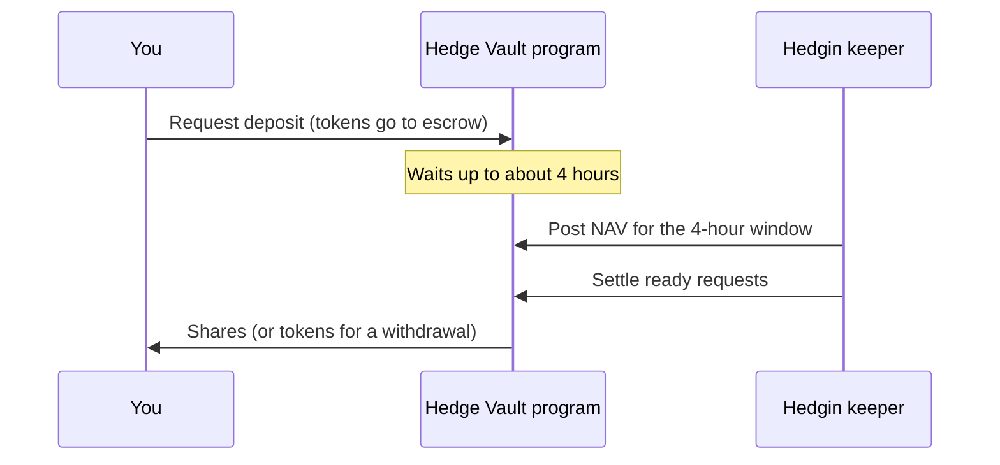
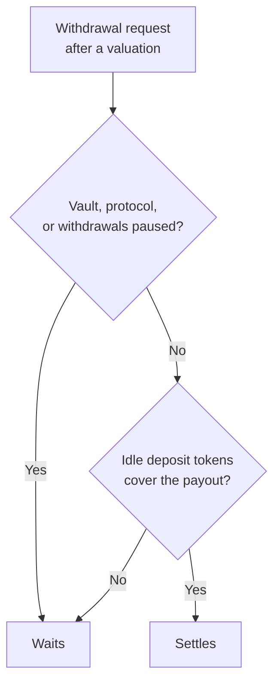
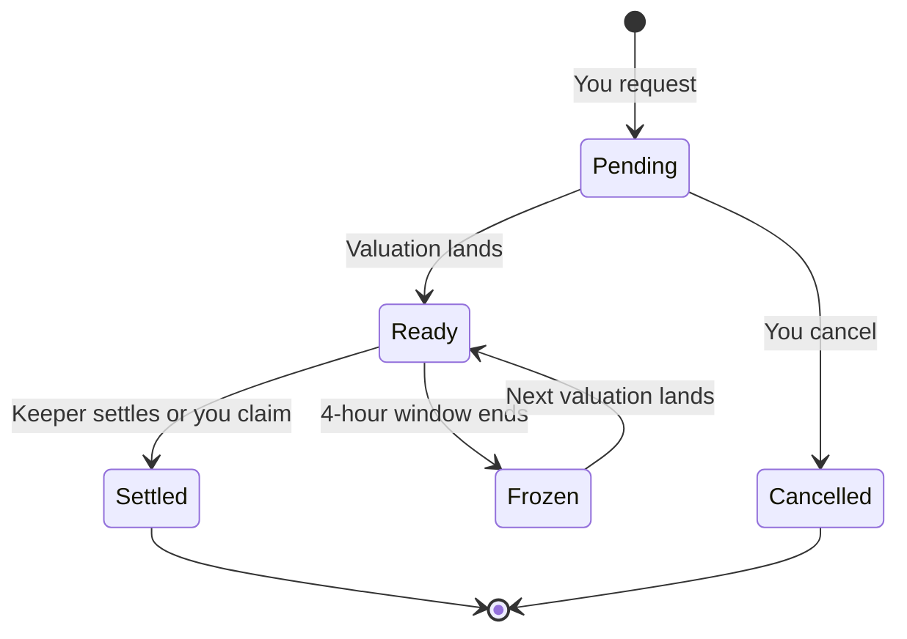

Deposits and withdrawals on Hedgin are requests. You create a request, it waits for the vault's next valuation, and then it settles at that price. This page shows each step on the [Hedgin website](https://hedgin.xyz/vaults). To learn why requests wait, read [Vaults, shares, and NAV](/concepts/vaults-and-nav).

You need:

| Item | Why |
| --- | --- |
| A browser Solana wallet, such as Phantom or Solflare | To sign each request. |
| The vault's deposit token, for example USDC for a USDC vault | The vault accepts only this token. |
| A small amount of SOL | To pay network fees and account rent. |

**Rent** is a refundable SOL deposit that Solana charges to store an account. The rent for a request comes back to you when the request closes.

<Warning>
Hedgin runs on Solana mainnet. Every transaction you approve moves real tokens. Read what your wallet shows before you approve it.
</Warning>

## Choose a vault

Open [hedgin.xyz/vaults](https://hedgin.xyz/vaults) and select a vault to open its page. Check these facts before you deposit:

| Fact | What it tells you |
| --- | --- |
| **Status** | **Active** accepts deposits. **Reduce only** and **Paused** do not. |
| **Deposit token** | The only token the vault accepts. |
| **Share price** | The vault's NAV per share: the value of one share at the last valuation. |
| **Fees** | The manager's performance fee and management fee. |
| **Deposit cap**, **Minimum deposit** | Limits, in the **Details** section. |
| **Last NAV update** | When the vault was last valued, and when requests become claimable. |

<Note>
The vault value shown at the top is a live estimate. Requests settle at the posted NAV, not at the live estimate.
</Note>

## Deposit

<Steps>
  <Step title="Connect your wallet">
    On the vault page, connect your wallet. The **Your position** panel shows your shares and their value.
  </Step>
  <Step title="Enter an amount">
    Select the **Deposit** tab. Enter an amount in the deposit token, or select **Max**. The panel shows **Estimated shares** at the current share price.
  </Step>
  <Step title="Request the deposit">
    Select **Request deposit** and approve the transaction in your wallet. The program moves your tokens into the vault's escrow. **Escrow** is a holding account that the program controls. Your tokens wait there and are not invested yet.

    In a SOL vault, the website wraps your SOL into wrapped SOL for you. It leaves 0.01 SOL in your wallet for fees.
  </Step>
  <Step title="Wait for the next NAV">
    The request card shows **Pending NAV update**. The vault is valued once in each 4-hour window that starts at 00:00, 04:00, 08:00, 12:00, 16:00, or 20:00 UTC. Your request becomes ready after the next valuation, so the wait is up to about 4 hours.
  </Step>
  <Step title="Receive your shares">
    The Hedgin keeper settles ready requests right after each valuation, so your shares usually arrive without any action. If the card shows **Ready to claim**, select **Claim shares** to settle it yourself.
  </Step>
</Steps>

### Why a deposit request can fail

The website checks these rules before you sign, and the program checks them again:

| Cause | What to do |
| --- | --- |
| The amount is below the vault's **Minimum deposit**. | Deposit more. |
| The amount exceeds the space left under the **Deposit cap**. The cap includes deposits that other people have requested but that have not settled yet. | Deposit less, or wait for space. |
| The manager has paused deposits, or the vault is reduce-only or paused. | Wait until deposits reopen. |
| You have an older deposit request in this vault that has not settled. | Claim it or cancel it first. |

A second deposit in the same 4-hour window adds to your open request instead.

## Withdraw

<Steps>
  <Step title="Enter a share amount">
    On the vault page, select the **Withdraw** tab. Enter the number of shares to sell, or select **Max**. The panel shows the **Estimated payout** at the current share price.
  </Step>
  <Step title="Request the withdrawal">
    Select **Request withdrawal** and approve the transaction. The program moves your shares into escrow.
  </Step>
  <Step title="Wait for the next NAV">
    The request waits for the next valuation, like a deposit.
  </Step>
  <Step title="Receive your tokens">
    The keeper settles the request after the valuation. The program burns your shares and pays the deposit token to your wallet. In a SOL vault, you receive native SOL. If the card shows **Ready to claim**, select the claim button, such as **Claim USDC**, to settle it yourself.
  </Step>
</Steps>

- Withdrawals stay open when a vault is reduce-only. Only a pause stops them.
- If your share balance is below the vault's **Minimum withdrawal**, you can still withdraw your whole balance.

## How much you receive

Both directions use the new NAV per share from the valuation that settles your request.

| Request | Formula | Example |
| --- | --- | --- |
| Deposit | deposit amount ÷ new NAV per share | 1,000 USDC ÷ 1.25 USDC = **800 shares** |
| Withdrawal | shares × new NAV per share | 800 shares × 1.30 USDC = **1,040 USDC** |

### Why a withdrawal can stay unsettled

**Idle** deposit tokens sit in the vault and are not invested in a strategy. If the manager has invested most of the vault, your request waits until the manager frees enough cash.

<Note>
The keeper does not close the manager's positions to pay you.
</Note>

## Follow your requests

Each open request moves through these states:

The vault page shows each open request with one of these labels:

| Label | Meaning | What you can do |
| --- | --- | --- |
| **Pending NAV update** | No valuation has happened since your request. | Wait, or cancel. |
| **Ready to claim** | A valuation landed in the current 4-hour window. | Wait for the keeper, or claim it yourself. |
| **Pending NAV update**, after a missed window | A valuation landed, but its 4-hour window ended before the request settled. The [Portfolio](https://hedgin.xyz/portfolio) page labels this state **Frozen**. | Wait for the next valuation. You cannot cancel or claim it now. |

The [Portfolio](https://hedgin.xyz/portfolio) page lists your positions and open requests across every vault. To claim or cancel, open the vault page.

A request that the website shows as sent is not finished until the chain confirms it. [How transactions work](/concepts/transactions) explains the difference.

## Cancel a request

You can cancel a request until the next valuation lands. After that, the request is locked to that price.

<Steps>
  <Step title="Open the vault page">
    Find the request card.
  </Step>
  <Step title="Select Cancel">
    On the request card, select **Cancel**.
  </Step>
  <Step title="Approve">
    Approve the transaction in your wallet.
  </Step>
</Steps>

The program returns your escrowed tokens or shares and the request's rent. Cancellation works even when the vault is paused.

If a vault's NAV per share is zero, you can cancel a deposit request at any time, because it can never settle.

## Use a direct integration

The website is the supported way to deposit and withdraw. The [manager bot API](/api-reference/introduction) does not offer deposit, withdrawal, or settlement actions. A team that builds its own Solana client can call the program directly with the [published IDL](https://hedgin.xyz/idl/hedge_vault.json). The program applies the same rules to every caller.
