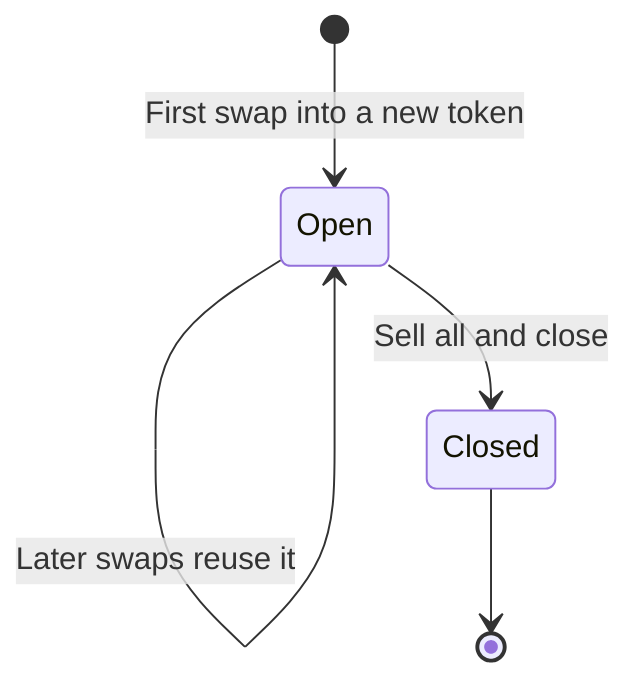
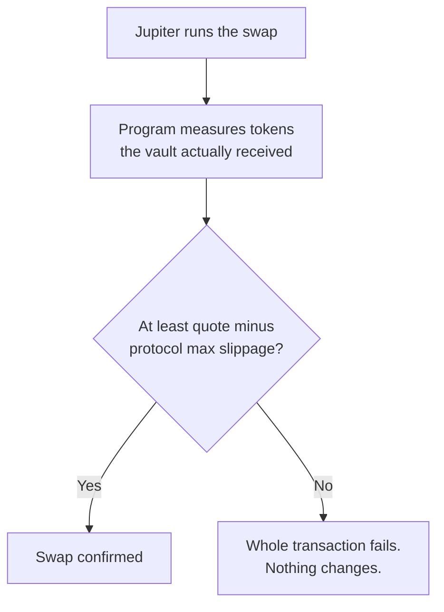

Jupiter is a Solana swap router: it finds the best path to exchange one token for another across many markets. A Hedgin vault swaps through Jupiter with the program's own checks around every trade. This page shows how to swap from the manager console.

Before you start, you need a vault you manage and a connected authority wallet. [Manage a vault](/managers/overview) covers both.

## How a vault tracks swapped tokens

Each token the vault buys gets a **Jupiter strategy**: a program record that tells the keeper to count that token in the vault's value. The deposit token never needs one, because the keeper always counts the idle balance.

| Event | What happens |
| --- | --- |
| First swap into a new token | Creates its strategy. Costs a small, refundable rent and can need a second wallet approval. |
| Later swaps into the same token | Reuse the strategy. |
| **Sell all & close**, or a normal swap that sells the full balance | Closes the strategy. |

A swap can go in any direction:

| From | To | Allowed when |
| --- | --- | --- |
| Deposit token | Another token | Always |
| Another token | Deposit token | Always |
| Non-deposit token | Another non-deposit token | The vault already tracks the token it sells. |
| Any token | The vault's own share token | Never |

## Swap a token

<Steps>
  <Step title="Open the Swap tab">
    Open the vault in the manager console and select the **Swap** tab. You can also open **Quick swap** from the Jupiter button on any tab.
  </Step>
  <Step title="Choose the tokens">
    Under **You pay**, choose the token to sell. Under **You receive**, choose the token to buy. To find a token, search by name or symbol, or paste its mint address. The check mark and score next to a token are Jupiter's information. They are not a Hedgin approval.
  </Step>
  <Step title="Enter the amount">
    Enter the amount to sell. The card shows the **Rate**, **Price impact**, **Minimum received**, and **Route**.
  </Step>
  <Step title="Set the slippage">
    Select the slippage setting and pick 0.1%, 0.5%, 1%, or 3%, or enter a custom value. **Slippage** is how far the final price may move against you before the trade fails. The card shows the **Protocol maximum**, and you cannot go above it.
  </Step>
  <Step title="Review and approve">
    Select **Review swap**, check the details, and approve the transaction. A quote expires after 30 seconds. If it expires, the card fetches a new one.
  </Step>
</Steps>

### How the program checks the result

If the button shows **Vault not operational**, the vault or the protocol is not in the Normal status. Swaps are blocked while reduce-only or paused.

## Sell a token back to the deposit token

To exit a token fully, sell all of it and close its strategy in one transaction:

1. Open the **Portfolio** tab.
2. On the token's row, select **Sell all & close**.
3. Approve the transaction.

This step fails in two cases:

| Cause | Result | What to do |
| --- | --- | --- |
| An open Meteora DLMM position or limit order still uses the token. | The transaction fails. | Close the position or the order first. |
| Jupiter has no route for the token. | The token stays in the vault, and its strategy stays open so the keeper keeps counting it. | Try again when a route exists. |

## Use a bot

A bot can quote and swap through the [manager bot API](/api-reference/introduction).

| Action | Use |
| --- | --- |
| `jupiter/initialize` | Create a Jupiter strategy. |
| `jupiter/swap` | Swap. A swap into a new token can return a second step that the bot must send after the first one confirms. |
| `jupiter/sweep` | Sell all and close. |

The SDK and API reference describe the request fields.
