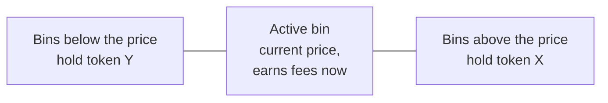
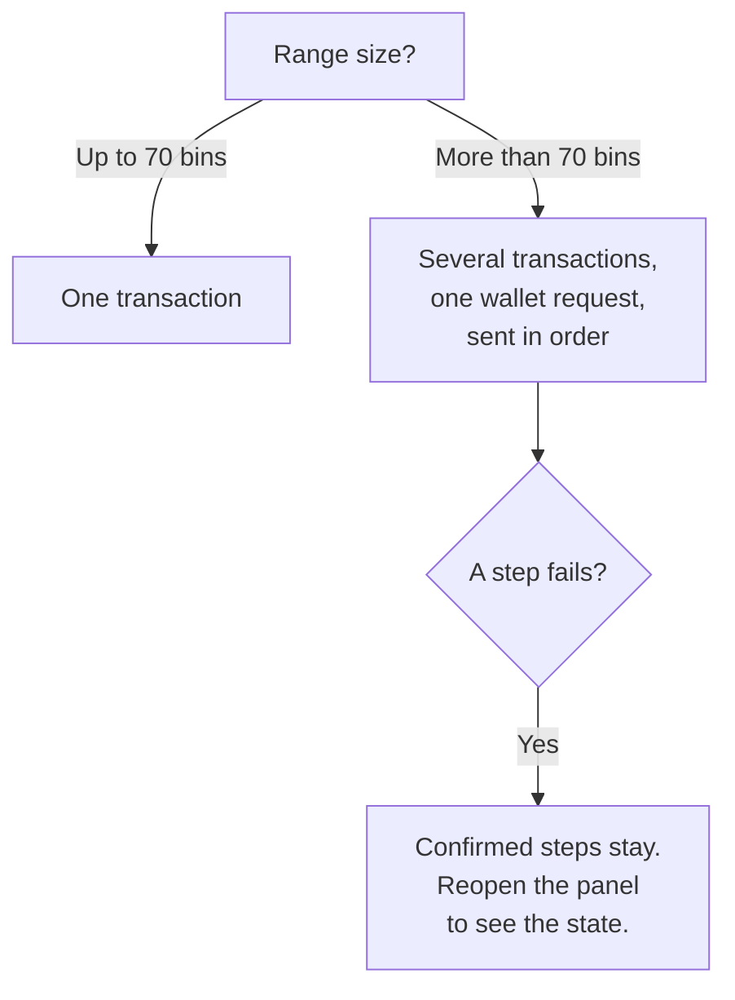
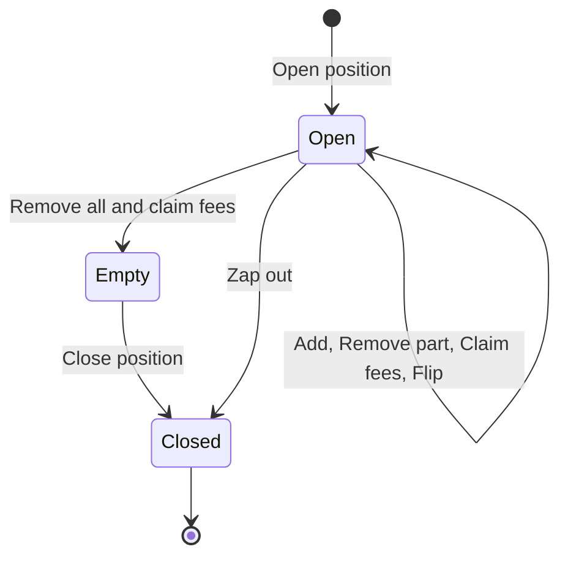
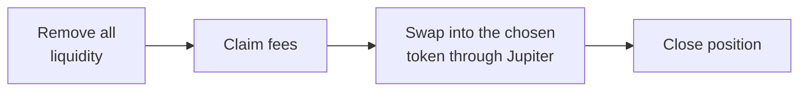
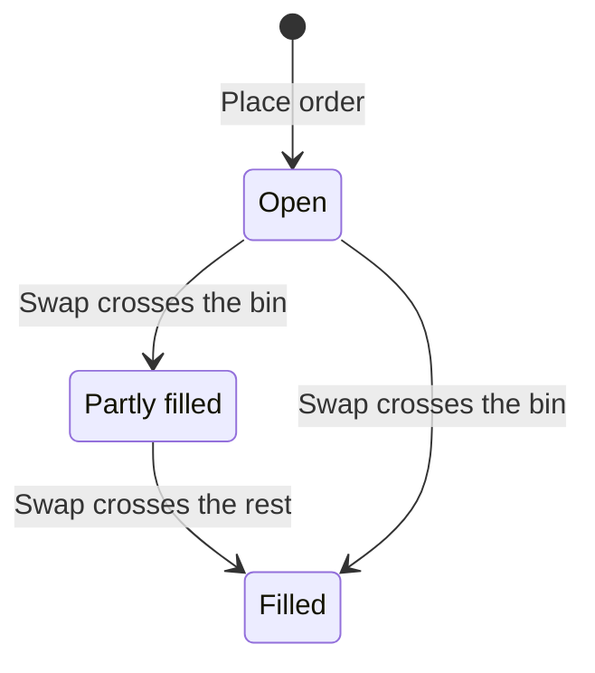

Meteora DLMM (Dynamic Liquidity Market Maker) is a type of trading pool on Solana. You add two tokens to a pool, traders swap against them, and you earn a share of the trading fees. A Hedgin vault can hold DLMM positions and limit orders. This page shows how to run them from the manager console.

## How DLMM liquidity works

A DLMM pool splits its price range into **bins**. Each bin covers one small price step and holds liquidity at that price. A **position** is your liquidity spread across a range of bins.



- The **active bin** holds the current pool price. Only liquidity in the active bin earns fees from trades at that moment.
- Token X is the pool's first token. Token Y is the second. As the price moves through your range, trades convert one token into the other.
- The **bin step** is the price gap between two neighboring bins. A small bin step suits stable pairs. A large one suits volatile pairs.

### Pair rules for vaults

A vault can open a position in any pool. The program requires one thing first: each pool token other than the deposit token needs a Jupiter strategy, so the keeper counts it in the vault's value. The console creates any missing Jupiter strategy when you open a position or place a limit order.

| The keeper counts | The keeper does not count |
| --- | --- |
| The position's token amounts | Unclaimed Meteora farming rewards |
| The position's unclaimed fees | |

## Open a position

<Steps>
  <Step title="Choose a pool">
    Open the **Liquidity** tab and search for a pool. Compare the pair, bin step, current price, liquidity, and fees before you choose.
  </Step>
  <Step title="Set the price range">
    Drag the range on the chart, or type the lower and upper prices. The panel shows **Total bins**, up to 1,400. The default range is 70 bins around the current price.
  </Step>
  <Step title="Pick a shape">
    Under **Strategy**, pick how the liquidity spreads across the range. See [Liquidity shapes](#liquidity-shapes).
  </Step>
  <Step title="Enter the amounts">
    Enter how much of each token to add. **Auto-fill on drag** keeps the two amounts in line with the range.
  </Step>
  <Step title="Open the position">
    Select **Open position** and approve the transactions. The panel shows the **Position rent deposit**. Meteora refunds it when the position closes.
  </Step>
</Steps>

### Liquidity shapes

The charts show the idea, not exact amounts. The middle bar is the bin at the current price.

<Tabs>
  <Tab title="Spot">
    The same amount in every bin.

    ```mermaid
    xychart-beta
        x-axis ["-3", "-2", "-1", "Price", "+1", "+2", "+3"]
        y-axis "Liquidity" 0 --> 10
        bar [5, 5, 5, 5, 5, 5, 5]
    ```
  </Tab>
  <Tab title="Curve">
    More near the current price, less at the edges.

    ```mermaid
    xychart-beta
        x-axis ["-3", "-2", "-1", "Price", "+1", "+2", "+3"]
        y-axis "Liquidity" 0 --> 10
        bar [1, 3, 6, 9, 6, 3, 1]
    ```
  </Tab>
  <Tab title="Bid-Ask">
    More at the edges, less near the current price.

    ```mermaid
    xychart-beta
        x-axis ["-3", "-2", "-1", "Price", "+1", "+2", "+3"]
        y-axis "Liquidity" 0 --> 10
        bar [9, 6, 3, 1, 3, 6, 9]
    ```
  </Tab>
</Tabs>

### Wide ranges



[How transactions work](/concepts/transactions) explains why confirmed steps stay.

## Manage a position

Select the position in the **Liquidity** tab or the **Portfolio** tab. A position moves through these states:



The position panel has three modes:

| Mode | What it does |
| --- | --- |
| **Add** | Adds more of either token to the existing range. |
| **Remove** | Pick a percentage, then select the remove button, for example **Remove 50%**. That share of the liquidity goes back to the vault. |
| **Claim fees** | Moves the fees the position has earned into the vault. |

### Flip one side to Bid-Ask

After the price moves, part of your range can hold only one token. **Flip** removes the selected bins that hold only the non-deposit token and adds the same amount back in a Bid-Ask shape, in one transaction.

1. Select the bins to flip.
2. Select **Flip** followed by the token name, for example **Flip SOL to Bid-Ask**.
3. Approve the transaction.

<Note>
Flip does not claim fees. If the pool price moves before the transaction lands, it fails. Refresh and try again.
</Note>

## Exit a position

**Zap out** exits a position in one action:



1. Open the position panel.
2. Select **Zap out**.
3. Under **Receive in**, choose either pool token, for example **USDC** or **SOL** in a SOL-USDC pool.
4. Approve the transactions. Positions up to 1,400 bins need one wallet approval.

- Zap out works only when the pool includes the deposit token.
- When you receive the deposit token, a follow-up sale sells any of the other token the vault still holds. When you receive the other token, the vault keeps it and no sale follows.
- In each transaction, the remove, the claim, and the swap happen together. If the swap fails, that whole transaction fails, so the vault never holds a half-finished step.
- A restarted zap out builds transactions only for the bins that still hold tokens or fees.

To exit by hand instead, remove all liquidity, claim the fees, and select **Close position**.

### What the status allows

| Action | Vault reduce-only | Vault paused | Protocol reduce-only or paused |
| --- | --- | --- | --- |
| Open a position, add liquidity | Blocked | Blocked | Blocked |
| Remove liquidity, claim fees | Allowed | Blocked | Blocked |

## Place a limit order

A DLMM **limit order** rests one token in up to 50 bins, waiting for the price to reach it. When a swap crosses an order's bin, the order fills at that bin's price and earns a maker fee. The proceeds and fees stay inside the order until you cancel it.

| Side | Token | Limit price must be |
| --- | --- | --- |
| **Sell X** | Sells token X | Above the pool price |
| **Buy X** | Buys token X | Below the pool price |

The limit price is in token Y per token X.

<Steps>
  <Step title="Choose the side">
    Open the limit order card for a pool. Select **Sell X** or **Buy X**.
  </Step>
  <Step title="Set the price and amount">
    Enter the **Limit price** and the amount.
  </Step>
  <Step title="Place the order">
    Select **Place order** and approve the transaction. The order appears as a strategy.
  </Step>
</Steps>

Each bin of the order shows one of these states:



To cancel, select **Cancel order** in the **Portfolio** tab. The vault receives the unfilled amount, the fill proceeds, and the maker fees. Cancelling the whole order also closes its strategy in the same transaction.

## Use a bot

The [manager bot API](/api-reference/introduction) covers every DLMM action in this guide: pool search, opening, adding, removing, flipping, claiming, zap out, closing, and limit orders.

<Warning>
Wide positions return several transactions with ordering markers, and some actions return a follow-up step. A bot must follow those markers exactly.
</Warning>

The API reference describes each action's fields.
