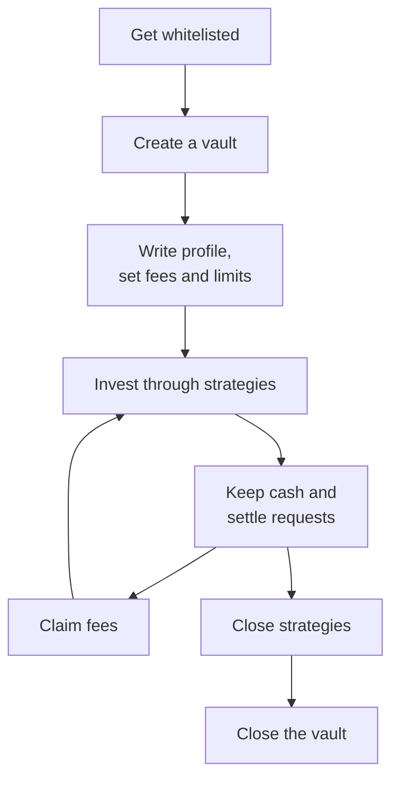
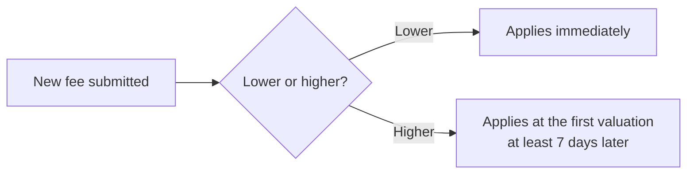
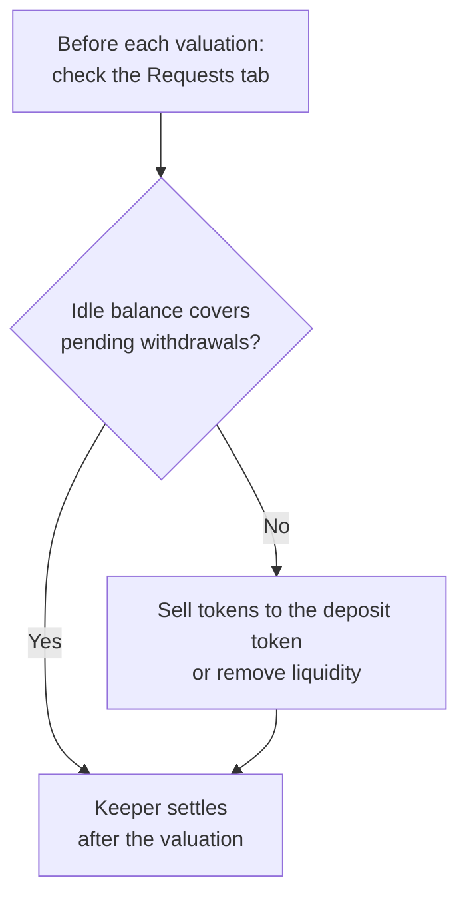
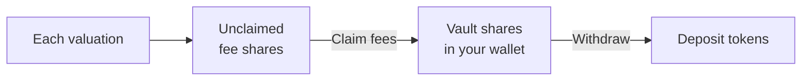
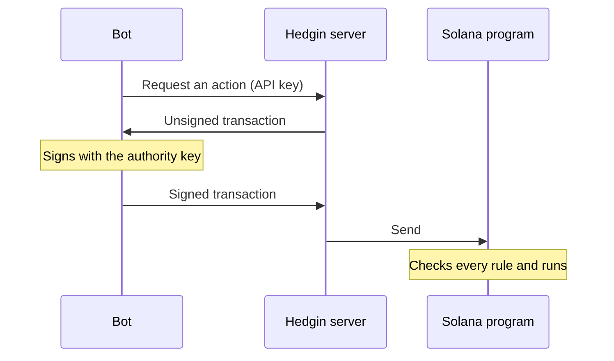

This guide follows a vault through its whole life in the [Hedgin manager console](https://hedgin.xyz/manage). Each section is one task. Read [How the Hedgin protocol works](/concepts/protocol) and [Vaults, shares, and NAV](/concepts/vaults-and-nav) first if you are new to Hedgin.

<Warning>
Hedgin runs on Solana mainnet. Every transaction you approve moves real vault funds. The program checks every action, but it cannot stop a bad trade that follows its rules.
</Warning>

## Get whitelisted

Only whitelisted wallets can create vaults. A Hedgin administrator adds wallets to the whitelist. There is no self-service sign-up.

<Steps>
  <Step title="Create a new wallet">
    Use it only to manage your vaults. Do not use your daily wallet. See [Prepare the manager wallet](#prepare-the-manager-wallet).
  </Step>
  <Step title="Fund it">
    Send SOL to the new wallet for rent and network fees.
  </Step>
  <Step title="Ask Hedgin">
    Send its public address to Hedgin and ask to be added as a manager.
  </Step>
  <Step title="Connect">
    Open [hedgin.xyz/manage](https://hedgin.xyz/manage) and connect that wallet. If the page shows **Not a manager yet**, the wallet is not on the whitelist yet.
  </Step>
</Steps>

### Prepare the manager wallet

Before you send an address to Hedgin, check these two things:

1. **Use a new wallet, not your daily wallet.** The whitelisted wallet becomes the authority of every vault it creates, and that cannot move to another wallet later. A dedicated wallet keeps vault control apart from your personal funds, approvals, and dapp connections. If your daily wallet leaks, your vaults stay safe.
2. **Fund the wallet with SOL before you start.** The manager wallet pays the rent and network fees for every account it creates. **Rent** is a refundable SOL deposit that Solana charges to store an account.

| Account | Rent |
| --- | --- |
| Vault | About 0.012 SOL |
| Each new strategy, Meteora position, and Phoenix account | More on top |
| **Suggested starting balance** | **0.1 SOL or more** |

Most rent comes back when you close the strategy or vault.

## Create a vault

<Warning>
The wallet that creates a vault becomes its **authority**: the only key that can manage it. The program has no way to move a vault to another wallet. If you lose this key, you lose control of the vault. Store it as carefully as the funds it will manage.
</Warning>

<Steps>
  <Step title="Open the dialog">
    On the **Your vaults** page, select **New vault**.
  </Step>
  <Step title="Fill in the fields">
    Enter each field in the table below. Open **Limits** to set the three limits.
  </Step>
  <Step title="Approve the transaction">
    Select **Create vault** and approve the transaction. The console opens your new vault.
  </Step>
</Steps>

| Field | Rule | Default |
| --- | --- | --- |
| **Name** | Up to 32 bytes. The program stores it on chain. | None |
| **Deposit token** | **USDC**, **USDT**, or **SOL**. You cannot change it later. To trade [Phoenix perpetuals](/managers/phoenix-perps), pick USDC. | None |
| **Performance fee (%)** | At most 50 | 10% |
| **Management fee (%/yr)** | At most 5 | 2% |
| **Deposit cap**, **Minimum deposit**, **Min. withdrawal (shares)** | Each must be greater than zero. | None |

The new vault starts with a NAV per share of 1 deposit token and the **Normal** status. It accepts deposit requests right away.

## Write the vault profile

Depositors read your profile on the public vault page. The profile is display information stored by Hedgin, not on the Solana program.

1. Open the vault's **Settings** tab.
2. In **Profile**, fill in **Display name**, **Strategy**, tags, and **Description**. The description accepts Markdown, but images and HTML do not appear.
3. Select **Save profile**. Your wallet asks you to sign a message. Signing a message is not a transaction and costs no fees.

To set your manager name and X handle for all your vaults, use **Manager profile** on the **Your vaults** page.

## Change settings and fees

All settings live in the **Settings** tab under **Vault settings**. Only the fields you change are sent. Select **Save changes** and approve the transaction.

| Setting | Rule |
| --- | --- |
| **Performance fee (%)**, **Management fee (% / year)** | See the fee timing chart below. Submitting new fees replaces a scheduled change. |
| **Deposit cap**, **Minimum deposit**, **Minimum withdrawal (shares)** | The minimums must stay above zero. |
| **Status** | **Normal**, **Reduce only**, or **Paused**. |
| **Pause** switches for **Deposits** and **Withdrawals** | Each switch blocks new requests and their settlement. Depositors can still cancel. |

A delay on increases lets depositors leave first. The tab shows when a scheduled increase takes effect.

| Status | Effect |
| --- | --- |
| **Normal** | Everything works. |
| **Reduce only** | Stops deposits and new risk, but lets depositors leave. |
| **Paused** | Stops almost everything. |

[What the status and pause switches block](/concepts/vaults-and-nav#what-the-status-and-pause-switches-block) lists every action each setting allows.

## Invest the vault

The console has one tab for each trading venue. Each guide explains the full flow:

<CardGroup cols={3}>
  <Card title="Jupiter swaps" icon="arrows-rotate" href="/managers/jupiter-swaps">
    Swap the deposit token into other tokens and back.
  </Card>
  <Card title="Meteora DLMM" icon="chart-column" href="/managers/meteora-dlmm">
    Provide liquidity in price bins and place limit orders.
  </Card>
  <Card title="Phoenix perps" icon="chart-line" href="/managers/phoenix-perps">
    Trade leveraged long and short positions from a USDC vault.
  </Card>
</CardGroup>

| Tab or control | What it does |
| --- | --- |
| **Portfolio** tab | Lists every holding with its actions, such as **Sell all & close** or **Zap out**. |
| Floating Jupiter button | Opens **Quick swap** from any tab. |
| **History** tab | Shows closed strategies with their token flows and profit or loss. |

Every position you open is a **strategy**: a program record that ties the holding to your vault. The keeper values only holdings that a strategy tracks. [What the keeper counts](/concepts/vaults-and-nav#what-the-keeper-counts) has the full list.

## Keep cash for withdrawals

A withdrawal settles only if the vault's idle balance covers the payout. The **idle balance** is the deposit token sitting in the vault outside any strategy.

<Warning>
The keeper never closes your positions to pay a withdrawal.
</Warning>

## Settle requests

The keeper settles ready requests right after each valuation. You do not need to act in most cases.

If a request stays ready, for example because you just freed cash for a withdrawal, settle it yourself:

1. Open the **Requests** tab. Ready requests show the **Ready** state.
2. Select **Resolve** on one request, or **Resolve all ready** for all of them.
3. Approve the transaction.

A bar at the top of other tabs also shows ready requests, with **Review** and **Resolve all** buttons.

<Note>
A request can settle only in the 4-hour window of its valuation. After that window ends, it waits for the next valuation.
</Note>

## Claim your fees

Fees build up as unclaimed vault shares at each valuation.

1. Open the **Portfolio** tab.
2. Under **Your fees**, select **Claim fees →**. If you see **Nothing to claim yet**, no fees have built up.
3. Approve the transaction.

The program sends the fee shares to your wallet. They are ordinary vault shares. To turn them into deposit tokens, withdraw them like any depositor.

## Close strategies

Close a strategy when you no longer need it. Closing returns the account rent to your wallet. The holding must be empty first.

| Holding | How to close it |
| --- | --- |
| Swapped token | Select **Sell all & close** in the **Portfolio** tab. |
| DLMM position | Select **Zap out** or remove all liquidity, then select **Close position**. |
| DLMM limit order | Select **Cancel order**. Cancelling the whole order also closes its strategy. |
| Phoenix | Close all positions, withdraw all collateral, wait for queued withdrawals, then select **Close strategy**. |

## Close the vault

<Warning>
Closing a vault deletes its accounts and returns their rent to your wallet. You cannot undo it.
</Warning>

The vault must meet all of these conditions first:

| Condition | Meaning |
| --- | --- |
| Share supply is zero | Every depositor has withdrawn, and you have withdrawn your own fee shares. |
| No pending requests | No deposit or withdrawal request is pending. |
| No unclaimed fee shares | You have claimed all your fees. |
| Every strategy is closed | See [Close strategies](#close-strategies). |
| Total assets are zero | A valuation after the last withdrawal records this. |
| Idle balance is zero | No deposit token sits in the vault. |

<Steps>
  <Step title="Open the close panel">
    Open the **Settings** tab and expand **Advanced: close vault**.
  </Step>
  <Step title="Check the preconditions">
    The panel shows **All preconditions are met.** Otherwise it lists what is left.
  </Step>
  <Step title="Close">
    Select **Close vault** and confirm.
  </Step>
  <Step title="Approve">
    Approve the transaction.
  </Step>
</Steps>

## Automate with a bot

The [manager bot API](/api-reference/introduction) lets a bot build the same transactions that the console builds. The bot signs each transaction with the vault's authority key on its own machine. A Hedgin administrator issues the API key. Each key lists the vaults and the exact actions it may use.

| Task | Web console | Bot API |
| --- | --- | --- |
| Create a vault | Yes | Yes, with a key that has no vault list |
| Change settings, fees, status, or pause switches | Yes | Yes |
| Edit the vault or manager profile | Yes | No |
| Jupiter swaps, strategy setup, and sell-all | Yes | Yes |
| Meteora DLMM positions and limit orders | Yes | Yes |
| Phoenix setup, collateral, orders, and unwrap | Yes | Yes |
| Claim manager fees | Yes | Yes |
| Close strategies and the vault | Yes | Yes |
| Settle deposit and withdrawal requests | Yes | No |
| Deposit or withdraw | Yes, on the vault page | No |

A feature in the console does not imply a bot endpoint. The [API reference](/api-reference/introduction) is the list of supported actions.
