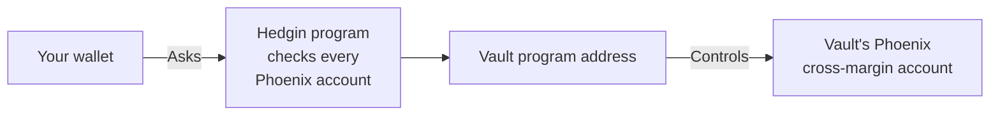
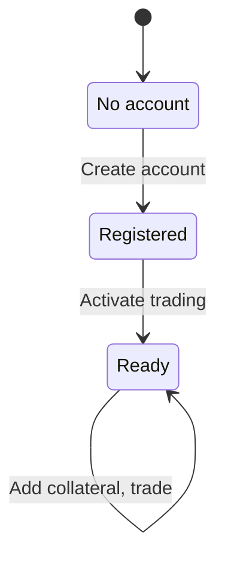
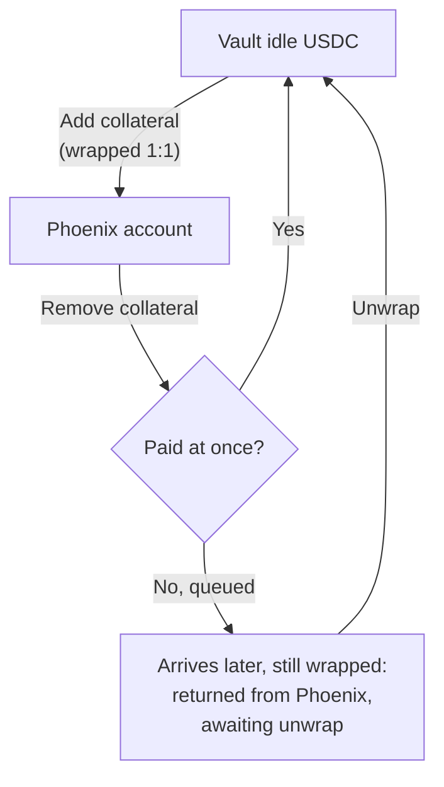

Phoenix Perpetuals is a Solana market for **perpetual futures**, usually called perps. A perp lets you bet on a price going up (long) or down (short), often with **leverage**: a position larger than the collateral behind it. A Hedgin vault can trade perps from its own Phoenix account. This page shows how, from the **Perps** tab of the manager console.

<Warning>
Leverage magnifies losses as well as gains. If losses use up the account's margin, Phoenix **liquidates** the account: it closes positions at a loss to cover them. The vault can lose all the collateral it moved into Phoenix.
</Warning>

## What you need

| Requirement | Why |
| --- | --- |
| A vault whose deposit token is **USDC** | Phoenix settles in USDC, so the program accepts Phoenix only for USDC vaults. |
| Idle USDC in the vault | To use as collateral. |
| The vault's authority wallet, connected to the console | To approve each action. |

## How the vault's Phoenix account works

Each vault gets at most one Phoenix **cross-margin account**. Cross-margin means all positions in the account share one pool of collateral.

The vault's program address controls the account, not your wallet.

**Collateral** is the USDC that backs your positions. When you add collateral, Phoenix's Ember service wraps the vault's USDC one-for-one into the token Phoenix uses internally. The vault's USDC still counts toward its value while it sits in Phoenix.

### How the keeper values the account

| Rule | Detail |
| --- | --- |
| Value | **Equity** = collateral + open profit and loss at the current mark price. |
| Floor | Equity never counts below zero. |
| Stale price | If any open position's market has a mark price older than about 10 minutes, the keeper does not post a NAV for the vault until the price updates. |

## Set up trading

The **Perps** tab shows **Enable perps trading** until setup is done. Setup is two transactions, once per vault.

<Steps>
  <Step title="Create the account">
    Select **Create account** and approve the transaction. The program registers the vault's Phoenix account and records it as a strategy. You pay the account rent.
  </Step>
  <Step title="Activate trading">
    Select **Activate trading** and approve. You sign only as the fee payer. Phoenix then co-signs and submits the transaction, which turns on deposits and orders for the account.
  </Step>
  <Step title="Add collateral">
    Move some of the vault's idle USDC into the account. The next section shows how.
  </Step>
</Steps>

## Move collateral

1. In the account panel, select **Add** or **Remove**.
2. Enter the USDC amount.
3. Select **Add collateral** or **Remove collateral** and approve.

Phoenix can queue a large withdrawal instead of paying it at once. Select **Unwrap** to turn queued USDC back into USDC in the vault's idle balance.

The account panel also shows **Equity**, **Available to trade**, **Margin used**, **Account leverage**, and **Margin ratio**.

<Warning>
Phoenix liquidates the account when the margin ratio reaches 100%.
</Warning>

## Place an order

<Steps>
  <Step title="Pick the market and side">
    Choose a market, then select **Long** or **Short**.
  </Step>
  <Step title="Pick the order type">
    Select **Market** to trade now at the best available price, or **Limit** to set your own price and wait.
  </Step>
  <Step title="Set the size and leverage">
    Enter the size as **Margin** in USDC or as **Size** in the market's asset. Drag **Leverage** from 1x up to the market's maximum. The default is 5x, or the market maximum if that is lower.
  </Step>
  <Step title="Set the options">
    Pick the options in the table below.
  </Step>
  <Step title="Check and submit">
    Check **Est. fill price**, **Price impact**, **Est. liquidation price**, **Account leverage**, and **Fee**. Then submit and approve.
  </Step>
</Steps>

| Option | Effect |
| --- | --- |
| **Reduce only** | Shrinks an open position without opening or flipping one. |
| **Post only** | Makes a limit order rest on the book and pay the maker fee, or fail instead of trading at once. |
| Slippage, market orders | 0.1%, 0.5%, 1%, or 2%. |

| Tab | Shows |
| --- | --- |
| **Positions** | Your open positions. |
| **Open orders** | Your resting orders. Cancel an order here. |
| **Trade history** | Your past fills. |

### What the status allows

| Action | Normal | Reduce only | Paused |
| --- | --- | --- | --- |
| Add collateral | Yes | No | No |
| Remove collateral | Yes | Yes | No |
| Place limit orders | Yes | No | No |
| Place reduce-only market orders | Yes | Yes | No |
| Cancel orders | Yes | Yes | No |
| Unwrap queued USDC | Yes | Yes | No |

In **Normal** status, every Phoenix action works. In **Paused** status, every Phoenix action is blocked.

## Wind down the account

To stop trading Perps and close the strategy:

<Steps>
  <Step title="Close every open position">
    In the **Positions** tab, the close action places a reduce-only market order that fills within 1% of the mark price or fails without trading.
  </Step>
  <Step title="Cancel every open order">
    Cancel them in the **Open orders** tab.
  </Step>
  <Step title="Remove all collateral">
    Use **Remove collateral** in the account panel.
  </Step>
  <Step title="Unwrap">
    Wait for any queued withdrawal to arrive, then select **Unwrap**.
  </Step>
  <Step title="Close the strategy">
    In the **Portfolio** tab, select **Close strategy** on the Perps row. The button stays disabled until the account is empty.
  </Step>
</Steps>

<Note>
Phoenix has no way to close a trader account, so the rent for that account stays with Phoenix.
</Note>

## Use a bot

The [manager bot API](/api-reference/introduction) covers the same flow: account setup, activation, collateral, orders, cancels, and unwrap. Activation is special: the bot submits it through a separate route, because Phoenix co-signs and sends it. The API reference describes each action and its status values.
