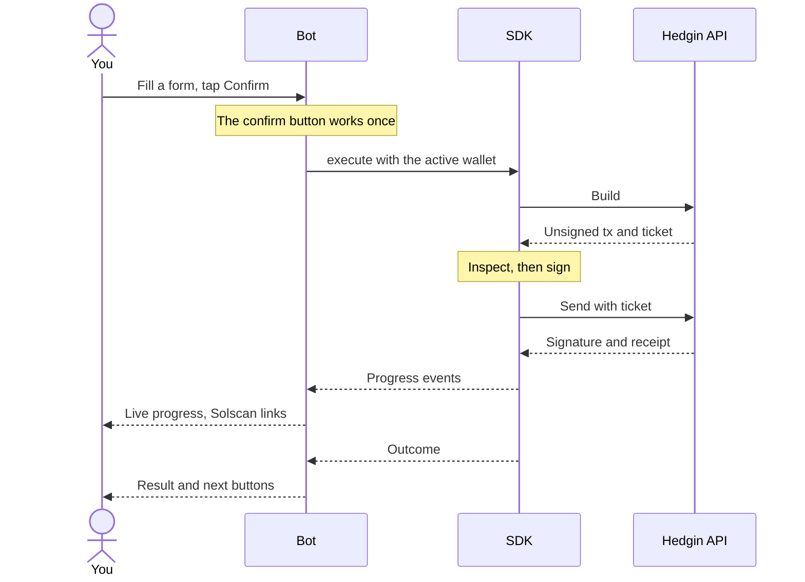
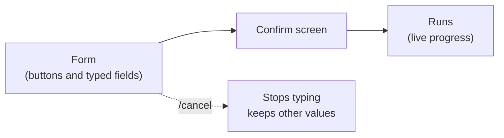

The Hedgin manager bot is a public Telegram bot that operates a vault through the [manager API](/api-reference/introduction). Each Telegram user keeps their own wallets in the bot. The bot reads vault state, builds transactions through the API, signs them with the active wallet, sends them, and shows live progress with Solscan links.

It runs on the same API and SDK as any other manager integration. If you want your key to stay in your own process, use the [TypeScript SDK](/sdk/overview) instead.

<Warning>
  **The bot is custodial.** When you import or create a wallet, the bot stores its private key on the server that runs it, encrypted with a master key that the bot's operator holds. The bot must hold the key, because it signs every transaction for you.

  - Anyone who has both the encrypted store and the master key controls every stored wallet, and every vault those wallets manage.
  - A vault's manager authority cannot be moved on chain. No program instruction transfers it. If a manager key leaks, you cannot rotate it away.
  - Telegram chats are not end-to-end encrypted. A key you paste passes through Telegram's servers before the bot deletes the message.
  - If the bot loses its data, any wallet it generated that you did not export is gone. Export a copy of every generated wallet.

  Import only a wallet whose risk you accept. Prefer a dedicated manager wallet over a wallet that holds other funds.
</Warning>

## Get started

You need two things before the bot can show a vault: a manager wallet and an API key issued for that wallet's address.

<Steps>
  <Step title="Open the bot in a private chat">
    The bot works only in private chats. It ignores groups, because you paste keys into the chat.
  </Step>
  <Step title="Add a wallet">
    Send `/wallet`, then tap **📥 Import wallet** to paste an existing private key, or **✨ New wallet** to create one. A new wallet manages no vault until a Hedgin admin whitelists it and it creates one.
  </Step>
  <Step title="Add the wallet's API key">
    Ask a Hedgin admin for an API key issued to this wallet's address, with the `read` scope and the action scopes you need. Tap **🔐 Add API key** and paste it. The bot checks the key against the API before it stores it.
  </Step>
  <Step title="Open your vaults">
    Send `/vaults`, or `/start`. Until the active wallet has an API key, `/start` opens the wallet menu instead.
  </Step>
</Steps>

Each API key is bound to one manager wallet, so every wallet needs its own key.

## Wallets

Open the wallet menu with `/wallet`. Vault screens, balances, and trades always use the **active** wallet and its API key.

| Button | What it does |
| --- | --- |
| 📥 Import wallet | Paste a private key as base58 (the format Phantom and Solflare export) or as a Solana CLI JSON array. The bot deletes your message at once. |
| ✨ New wallet | Creates a fresh keypair and makes it active. It shows a reminder to export the key. |
| 🔐 Add API key | Paste the `hv1_…` key an admin issued for the active wallet's address. The bot validates it with the API, deletes your message, and stores it. 🔐 Replace API key appears when one is already set. |
| 🔑 Export private key | After a warning, sends the key as a protected spoiler message that deletes itself after 60 seconds. |
| 🔀 My wallets · switch | Lists your wallets, up to 10. Tap one to make it active. 🗑 deletes the bot's copy of the key, after it asks you to confirm. |

Switching wallets expires the form and confirm buttons made for the previous wallet, so a stale button cannot act with the new key. Removing a wallet deletes the bot's only copy of the key and its API key. Funds stay on chain, but without your own copy of the key you lose access to them and to every vault the wallet manages.

If you paste something that looks like a private key anywhere other than the import prompt, the bot deletes the message and tells you to use `/wallet`.

## Commands

| Command | What it shows |
| --- | --- |
| `/start` | The vault list, or the wallet menu until the active wallet has an API key. |
| `/wallet` | Import, create, export, or switch wallets. |
| `/vaults` | A numbered list of the vaults the active wallet manages. |
| `/holdings <vault>` | Vault overview: live value against the last NAV, per-token exposure, open LP and perps positions. |
| `/strategies <vault>` | Open Jupiter, Meteora DLMM, and Phoenix strategies. |
| `/nav <vault>` | The last 10 posted NAVs, newest first, with admin overrides flagged. |
| `/requests <vault>` | Queued deposits and withdrawals, and whether each can settle yet. |
| `/history <vault>` | The last 10 closed strategies with realized PnL per token. |
| `/phoenix <vault>` | Phoenix perps: setup step, margin, positions, open orders. |
| `/settings <vault>` | Fees, limits, status, pause flags, pending totals. |
| `/help` | A short guide inside the chat. |
| `/cancel` | Stops typing into a form. The form keeps its other values. |

`<vault>` is a vault address, its number from `/vaults`, or its name. Telegram's `/` menu lists only `/start`, `/wallet`, `/vaults`, `/help`, and `/cancel`, but every command above works when you type it. The vault screen also has a button for each read.

`/history` and `/nav` fail with `HistoryUnavailable` on a server without a history database. If an API response does not match the documented contract, the bot reports `contract_mismatch` instead of showing half-parsed data.

## Trade and manage

Every action follows the same path.

Fields you type into ask with a prompt. Answer in the chat or send `/cancel`. Amounts accept a number (`1.5`), a percent (`25%`), or `max`. Prices are the pool's quote token per base token.

The bot converts price ranges to bins. It shows the actual edge prices, the bin count, and which tokens the range can hold. It flags pasted tokens that Jupiter has not verified on the form and again on the confirm screen.

### Swaps and tokens

| Where | What you set | API action |
| --- | --- | --- |
| Vault → 💱 Swap | A held token, or a pasted contract address. 🟢 Buy or 🔴 Sell. An amount: 25%, 50%, Max, or a typed value. Slippage: 0.5%, 1%, 3%, or typed, up to the protocol's 3%. A quote shows first. | `jupiter/swap` |
| Strategies → ➕ Track token | A pasted contract address, with Jupiter verification shown. | `jupiter/initialize` |
| Strategies → 🧹 Sell all TOKEN & close | On each swap strategy that holds a non-deposit token. Sells the whole balance to the deposit token and closes the strategy in one transaction, at 1% slippage. The bot refuses while an open LP position or order uses the token. | `jupiter/sweep` |
| Strategies → 🗑 Close empty strategy | An empty strategy. | `strategy/close` |

### Meteora DLMM positions

| Where | What you set | API action |
| --- | --- | --- |
| Vault → ➕ New LP | A pool (pasted address, or a symbol search sorted by TVL), a side (X only, both, Y only), a shape (Spot, Curve, Bid-Ask), a range preset or typed min and max price, and the amount of each token the range can hold. | `dlmm/open`, with `dlmm/extend` past 70 bins |
| Vault → ➕ New LP → 🫙 Empty position | A pool and a range of up to 70 bins. | `dlmm/initialize` |
| Position → ➕ Add liquidity | A shape and the amount of each token. | `dlmm/add` |
| Position → 💰 Claim fees | None. | `dlmm/claim-fee` |
| Position → ➖ Remove liquidity | Which bins: all, only above the price, only below it, or the top or bottom 25% or 50% of the position's bins. Then 25%, 50%, or 100%. Picks with no liquidity are not offered. Without per-bin data from the API, only all bins is offered. | `dlmm/remove` |
| Position → 🔁 Flip TOKEN to Bid-Ask | None. Withdraws every bin of the non-deposit token (above the price for X, below it for Y) and re-adds it as Bid-Ask in one atomic transaction. It fails unchanged if the price moves more than 10 bins. It does not claim fees. When the bot does not offer it, the position card says why. | `dlmm/flip` |
| Position → 🔁 Zap out | None. Afterwards, any leftover non-deposit token is sold to the deposit token and its swap strategy is closed in one extra transaction, unless another open position or order still uses it. Slippage is 1%. | `dlmm/zap-out`, with `dlmm/zap-out/swap` and `jupiter/sweep` |
| Position → 🗑 Close position | None. Removes all liquidity and claims fees. | `dlmm/close` |

### Phoenix perpetuals

Phoenix needs a vault whose deposit token is USDC. The bot walks through setup in order.

| Where | What you set | API action |
| --- | --- | --- |
| Vault → 📈 Phoenix → 🚀 Set up Phoenix | None. Shown when the vault has no Phoenix strategy. | `phoenix/initialize` |
| Vault → 📈 Phoenix → 🤝 Onboard trader | None. Shown after setup. Phoenix co-signs this transaction. | `phoenix/onboard` |
| Vault → 📈 Phoenix → 💵 Deposit USDC · 📤 Withdraw | An amount. | `phoenix/deposit`, `phoenix/withdraw` |
| Vault → 📈 Phoenix → 🆕 New order | A market, long or short, a size such as `0.5`, then a market order with slippage (0.5%, 1%, 3%, or typed, up to 20%) or a limit order with a price and a post-only choice. A reduce-only choice. | `phoenix/order` |
| Vault → 📈 Phoenix | ✖️ Cancel all orders on one market. | `phoenix/cancel` |
| Vault → 📈 Phoenix | 🧹 Sweep a queued withdrawal. | `phoenix/sweep` |

### Vault settings and creation

| Where | What you set | API action |
| --- | --- | --- |
| Vault → ⚙️ Settings | Pause or resume deposits or withdrawals. Set the status to Normal, Reduce-only, or Paused. | `vault/update`, one field |
| Vault → ⚙️ Settings → ✏️ Edit fees and limits | Fees in percent, the deposit cap (or `none`), the minimum deposit, and the minimum withdrawal shares. | `vault/update`, only the changed fields |
| Vault → ⚙️ Settings | 💰 Claim manager fee. 🗑 Close vault. | `vault/claim-fee`, `vault/close` |
| Vaults → ✨ Create vault | A name of at most 32 bytes, a deposit token (USDC, or a pasted mint), fees in percent, a cap, a minimum deposit, and the minimum withdrawal shares. The bot offers 🏦 Open new vault when it lands. | `vault/initialize` |

The bot looks up a pasted deposit mint through a vault the key already manages. A manager's first vault must therefore use USDC. Pausing the vault, closing it, and closing a DLMM position show a plain-words warning on the confirm screen.

## Key scopes per feature

Every action needs the `send` scope plus its own action name. When a key lacks one, the bot names the missing action so you can ask the admin for it. See [Key scopes](/sdk/reference#key-scopes) for the full rule.

| Feature | Key actions |
| --- | --- |
| Any screen or command | `read` |
| Swap | `jupiter/swap` |
| Track token | `jupiter/initialize` |
| New LP position | `dlmm/open`, plus `dlmm/extend` for ranges over 70 bins |
| Empty position | `dlmm/initialize` |
| Add liquidity, claim fees, remove | `dlmm/add` (and `dlmm/add-range`), `dlmm/claim-fee`, `dlmm/remove` |
| Flip to Bid-Ask | `dlmm/flip` |
| Zap out | `dlmm/zap-out`, `dlmm/zap-out/swap`, `jupiter/sweep` |
| Sell all and close | `jupiter/sweep` |
| Close position, close empty strategy | `dlmm/close`, `strategy/close` |
| Phoenix setup | `phoenix/initialize`, then `phoenix/onboard` |
| Phoenix funds and trading | `phoenix/deposit`, `phoenix/withdraw`, `phoenix/order`, `phoenix/cancel`, `phoenix/sweep` |
| Settings | `vault/update`, `vault/claim-fee`, `vault/close` |
| Create vault | `vault/initialize`, on a key not limited to specific vaults |

## Safety behavior

The bot signs through the SDK, so it inherits the SDK's signing policy. The rules below are what you can rely on when you use it.

| Rule | What the bot does |
| --- | --- |
| Private chats only | The bot ignores groups. When the operator sets an allowlist of Telegram user IDs, users outside it get no reply at all, so the bot does not reveal that it exists. |
| Secrets are deleted | The bot deletes the message that holds a pasted private key or API key before it does anything else. An exported key appears as a protected spoiler message that deletes itself after 60 seconds. |
| Inspect before signing | Every transaction in a batch must be v0, paid by the manager key, already signed by any other required signer, and call only the Hedge Vault program, ComputeBudget, Associated Token Account, Meteora DLMM, or Jupiter at the top level. The priority fee is capped at 100,000 microLamports per compute unit. The bot refuses anything else without signing. Phoenix onboarding is the one exception: a single transaction that calls only the Phoenix program, which Phoenix co-signs on submit. See [Execute and safety](/sdk/safety) for the policy in detail. |
| Confirm first, one shot | Every action shows a confirm screen. A confirm button works once. Each user runs only one action at a time. |
| No blind retries | The bot polls an ambiguous send by its receipt. It never rebuilds after one, because a rebuild could execute the action twice. When it cannot tell what happened, it says so and links the transaction. |
| Buttons do not survive a restart | Form and confirm buttons stop working when the bot restarts, and half-typed answers are forgotten. Send `/start` for fresh buttons. |

<Note>
  By default the bot talks to the production API at `hedgin.xyz`, which runs on Solana mainnet. Every confirmed action moves real funds.
</Note>
