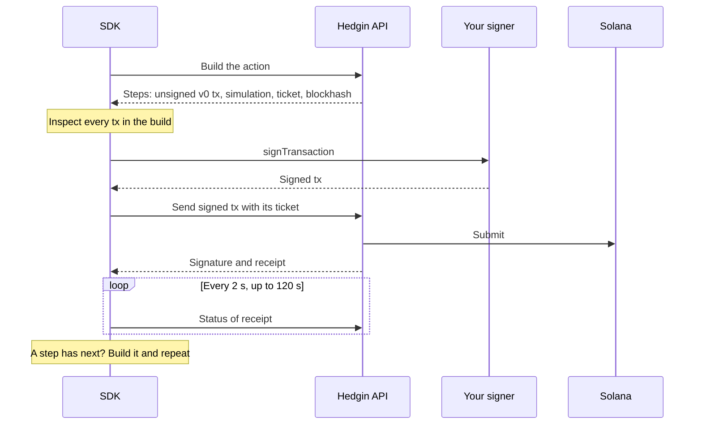
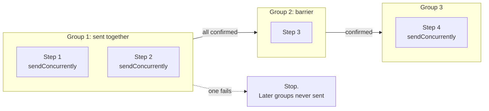
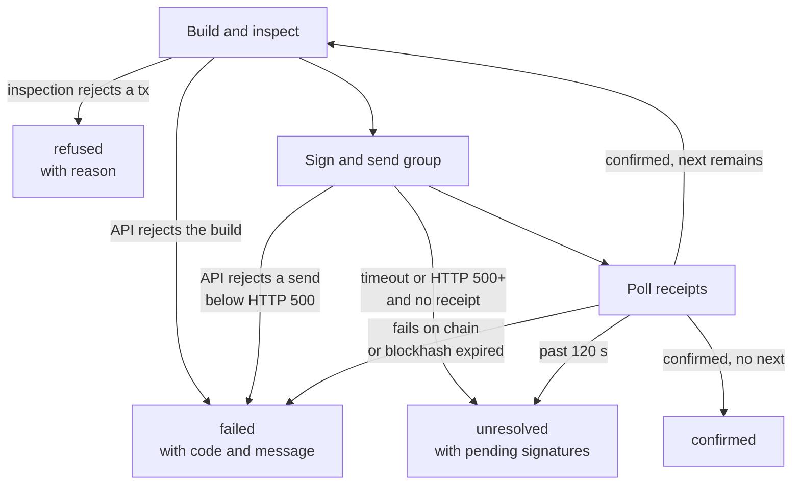

A manager key can sign real transactions on Solana mainnet. The SDK is built so that a wrong, hostile, or compromised API response cannot spend the manager wallet's funds. This page explains how `execute` works and what it refuses.

## What `execute` does

For one `ActionRequest`, `execute` runs this loop.



| Stage | What happens |
| --- | --- |
| Build | The builder endpoint returns one or more steps. Each step has an unsigned base64 v0 transaction, a simulation result, a `ticket`, and a `blockhash`. |
| Inspect | Every transaction in the build is checked against the [signing policy](#signing-policy). If any fails, nothing in that build is signed or sent, and `execute` returns `refused`. |
| Sign and send | Each transaction is signed with your `TransactionSigner` and posted with its `ticket`. The `ticket` is a short-lived (90 second) proof that the API built that exact message for your key. |
| Confirm | The SDK polls status until every sent transaction in the group is confirmed, one fails, or 120 seconds pass. |
| Continue | If a step carried a `next` continuation, the SDK builds it and starts again at Build. |

`onProgress` receives one event per stage:

| Event | When |
| --- | --- |
| `{ kind: "building", action }` | Before each build. |
| `{ kind: "sent", signature, status }` | After each send. `status` is `"pending"` or `"unknown"`. |
| `{ kind: "confirmed", signature }` | After the transaction's group confirms. |

```ts
const outcome = await hedge.execute(request, signer, {
  onProgress: (progress) => console.log(progress),
});
```

### Batches and confirmation barriers

A build can return several transactions. Steps marked `sendConcurrently` that sit next to each other form one group and go out together. Any other step is a barrier: it is sent alone, and the next group waits for it to confirm.



If a group fails, later groups are never sent. Transactions from earlier groups have already landed, and they stay landed.

### Continuations

Some builders cannot finish in one build. A step then carries `next`, a builder path and body. `execute` builds `next` after the current batch confirms, and keeps going until no step has a `next`.

| Continuation | When it appears |
| --- | --- |
| `dlmm/extend` | A position wider than 70 bins. |
| `dlmm/add-range` | After `dlmm/extend`. |
| `dlmm/zap-out/swap` | After a zap-out. |
| `jupiter/sweep` | After a zap-out. |

A key needs the scope of each continuation it follows. See [Key scopes](/sdk/reference#key-scopes). `execute` stops with the code `TooManySteps` after 12 builds. A longer chain means something is looping.

## Outcomes

`execute` returns an `Outcome` for every case the API and the network can explain.



An expired blockhash has the code `Expired`. On `confirmed`, `created.vault` or `created.position` is set when the action made one.

When an API error stops a send, the SDK still settles the transactions it already sent in that group before it reports the error. They may land. So `failed` does not mean nothing happened.

| Outcome | Was anything sent? | Call `execute` again right away? | What to do next |
| --- | --- | --- | --- |
| `confirmed` | Yes. Everything landed. | Not needed. | Use `signatures` and `created`. |
| `refused` | No. | Yes, it is safe. | Read `reason`. |
| `failed` | Maybe. An earlier transaction may have landed. | No. | Read vault state with the [read methods](/sdk/reference#vault-reads) first. |
| `unresolved` | Yes. The result is unknown. | No. | Look up the `pending` signatures on an explorer. |
| Error thrown while building | No. | Yes, it is safe. | Retry. |

```ts
switch (outcome.kind) {
  case "confirmed":
    console.log("Landed:", outcome.signatures);
    break;
  case "refused":
    console.error("Not signed:", outcome.reason);
    break;
  case "failed":
    console.error(outcome.code, outcome.message, "Earlier signatures:", outcome.signatures);
    break;
  case "unresolved":
    console.warn("Check these on an explorer before doing anything else:", outcome.pending);
    break;
}
```

### Unknown outcomes: poll, never rebuild

A transaction you sent is not a confirmed transaction. When a send times out or the server errors, the transaction may still have reached the network. The SDK records its signature, reports `status: "unknown"` through `onProgress`, and keeps it open.

If the send returned a receipt, the SDK polls that receipt every 2 seconds. If it returned no receipt, there is nothing to poll. When every open transaction in the group lacks a receipt, the outcome is `unresolved` at once.

<Warning>
  The SDK never rebuilds after an ambiguous send. A rebuild gets a fresh blockhash and a new signature, so it could execute the same action twice. Your code must follow the same rule:

  - On `unresolved`, look the signatures up on an explorer. Do not call `execute` again with the same request until you know what landed.
  - On `failed`, read vault state first. An earlier transaction in the batch may have landed.
  - Call `execute` again without checking only when nothing was sent: after a `refused` outcome, or after an error thrown while building.
</Warning>

### What `execute` throws

`execute` returns outcomes for API errors and policy refusals. It throws for the rest:

- A network error or timeout while building, before anything is signed. Nothing was sent, so a retry is safe.
- An error from your `signer`. If it happens after earlier transactions were sent, those signatures are visible only through `onProgress`. Record them there.

Status polling errors are swallowed and retried until the deadline.

## Signing policy

The API builds every transaction. The SDK does not trust that. It inspects the whole build before any part of it is sent, and a batch with one bad transaction is refused whole. The table compares this policy with the narrower [Phoenix onboarding policy](#phoenix-onboarding-policy).

| Rule | `execute` (signing policy) | `onboardPhoenix` (onboarding policy) |
| --- | --- | --- |
| Transaction version | v0 | v0 |
| Fee payer | The signer's key | The signer's key |
| Other signatures | Every other required signature already present, such as the new keypair of a DLMM position | One missing: Phoenix signs after the manager |
| Top-level programs | Hedge Vault, ComputeBudget, Associated Token Account, Meteora DLMM, Jupiter | Phoenix only (`EtrnLzgbS7nMMy5fbD42kXiUzGg8XQzJ972Xtk1cjWih`) |
| Priority fee | At or below 100,000 microLamports per compute unit | None. ComputeBudget is refused. |
| Shape of the build | Any number of steps and `next` continuations | One non-empty transaction, no `next` |
| Checked by | `inspectTransaction` | `inspectPhoenixOnboardTransaction` |

Token movement happens by cross-program invocation inside the Hedge Vault program, so none of the allowed top-level programs can transfer funds out of the manager wallet. The manager pays only rent (for example, associated token accounts and DLMM bin arrays) and the capped priority fee.

Change the cap with `maxComputeUnitPriceMicroLamports` in the [client options](/sdk/reference#createhedgeclient). Change the allowed program with `programId` only for a non-production deployment.

Use `inspectTransaction` directly to check a transaction yourself:

```ts
const policy: SigningPolicy = {
  manager,
  programId: HEDGE_VAULT_PROGRAM_ID,
  maxComputeUnitPriceMicroLamports: DEFAULT_MAX_COMPUTE_UNIT_PRICE_MICROLAMPORTS,
};
try {
  inspectTransaction(base64Transaction, policy);
} catch (error) {
  if (error instanceof UnsafeTransactionError) console.error(error.message);
  else throw error;
}
```

### Phoenix onboarding policy

`onboardPhoenix` uses a separate, narrower policy because Phoenix signs the transaction after the manager. The right-hand column of the table above lists its rules. No priority fee can be set at all.

This is the only path that signs while another signature is still missing. `execute` refuses a direct Phoenix call and any missing co-signature.

## Custom signers

`TransactionSigner` is an interface with a `publicKey` and a `signTransaction` method. A hardware wallet or a KMS-backed signer can replace `keypairSigner` without other changes. The signer must add its signature and keep the signatures the builder already added.

```ts
function myKmsSigner(manager: string, signWithKms: (tx: VersionedTransaction) => Promise<VersionedTransaction>): TransactionSigner {
  return { publicKey: new PublicKey(manager), signTransaction: signWithKms };
}
```

`keypairFromFile(path)` reads a Solana CLI keypair file, a JSON array of 64 bytes. Its errors never include the file contents.

## Errors

The SDK exports two error classes.

| Class | Fields | Thrown when |
| --- | --- | --- |
| `ApiError` | `status`, `code`, `message` | The API answers with a non-2xx status, or a 2xx body does not match the documented contract. |
| `UnsafeTransactionError` | `message` | `inspectTransaction` or `inspectPhoenixOnboardTransaction` rejects a transaction. |

Reads throw `ApiError` to your code. Inside `execute`, an `ApiError` becomes a `failed` outcome and an `UnsafeTransactionError` becomes a `refused` outcome.

The SDK adds two codes of its own to `ApiError`:

- `contract_mismatch`: the response was successful, but its shape differs from the schemas the SDK parses. The API and the SDK disagree. Run the [API checker](/sdk/api-checker).
- `unexpected_response`: the status was an error and the body was not the documented `{ error: { code, message } }` shape.

Other codes come from the API. See [errors and limits](/api-reference/errors-and-limits) for the list and the rate limits.
