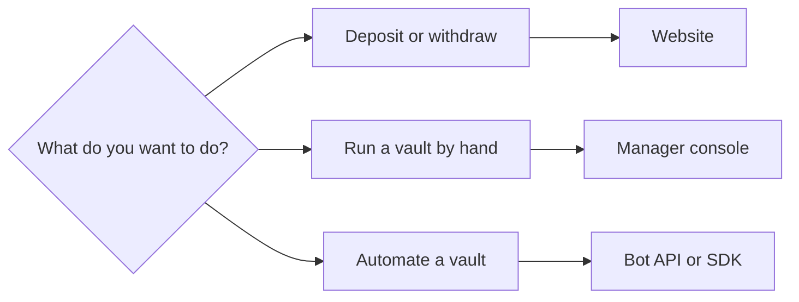

Hedgin has several ways in. Each fits a different goal and needs different access.

## Pick a tool for your goal

| Goal | Tool | What you need |
| --- | --- | --- |
| Browse vaults, their value, and their positions | [Vaults page](https://hedgin.xyz/vaults) | Nothing. No wallet or key. |
| Deposit or withdraw | [Vault page](https://hedgin.xyz/vaults) | A Solana wallet holding the vault's deposit token and a little SOL. |
| Run a vault by hand | [Manager console](https://hedgin.xyz/manage) | A manager wallet that a Hedgin administrator has whitelisted. |
| Automate a vault with a bot | [Manager bot API](/api-reference/introduction) | An API key that a Hedgin administrator issues, and the vault's authority key held by the bot. |
| Write a bot in TypeScript | [TypeScript SDK](/sdk/overview) | The same key and signer as the bot API. |
| Build your own Solana client | [Published IDL](https://hedgin.xyz/idl/hedge_vault.json) | Your own Solana client and signer. The program checks every role and account. |

<Note>
The bot API covers most manager actions. It does not cover deposits, withdrawals, or request settlement. Use the website for those.
</Note>

## Your first steps

<Tabs>
  <Tab title="Deposit">
    <Steps>
      <Step title="Learn why deposits wait">
        Read [Vaults, shares, and NAV](/concepts/vaults-and-nav) to learn why a deposit waits up to about 4 hours.
      </Step>
      <Step title="Deposit">
        Follow [Deposit into and withdraw from a vault](/depositors/deposits-and-withdrawals).
      </Step>
    </Steps>
  </Tab>
  <Tab title="Manage a vault">
    <Steps>
      <Step title="Get whitelisted">
        Ask a Hedgin administrator to whitelist your manager wallet. Use a new wallet, not your daily one, and fund it with SOL for rent first. See [Prepare the manager wallet](/managers/overview#prepare-the-manager-wallet).
      </Step>
      <Step title="Learn the rules">
        Read [How the Hedgin protocol works](/concepts/protocol) to learn what the program allows and blocks.
      </Step>
      <Step title="Run the vault">
        Follow [Manage a vault](/managers/overview) from vault creation to closing.
      </Step>
      <Step title="Invest">
        Use the guides for [Jupiter](/managers/jupiter-swaps), [Meteora DLMM](/managers/meteora-dlmm), and [Phoenix](/managers/phoenix-perps) as you invest.
      </Step>
    </Steps>
  </Tab>
  <Tab title="Build a bot">
    <Steps>
      <Step title="Get an API key">
        Ask a Hedgin administrator for an API key. The key names your manager public key, the vaults it may act on, and the exact actions it may use.
      </Step>
      <Step title="Store your secrets">
        Keep the API key and the vault's authority key in your bot's secret store. Never put either one in a URL, a log, a browser, or a prompt.
      </Step>
      <Step title="Learn the transaction path">
        Read [How Hedgin transactions work](/concepts/transactions). A bot that retries a send too early can run the same trade twice.
      </Step>
      <Step title="Call the API">
        Read the [API introduction](/api-reference/introduction). To skip writing the signing and polling loop yourself, use the [TypeScript SDK](/sdk/overview) or fork the [example Telegram bot](/managers/telegram-bot).
      </Step>
    </Steps>
  </Tab>
</Tabs>

AI agents can read an index of every page at [docs.hedgin.xyz/llms.txt](https://docs.hedgin.xyz/llms.txt).
